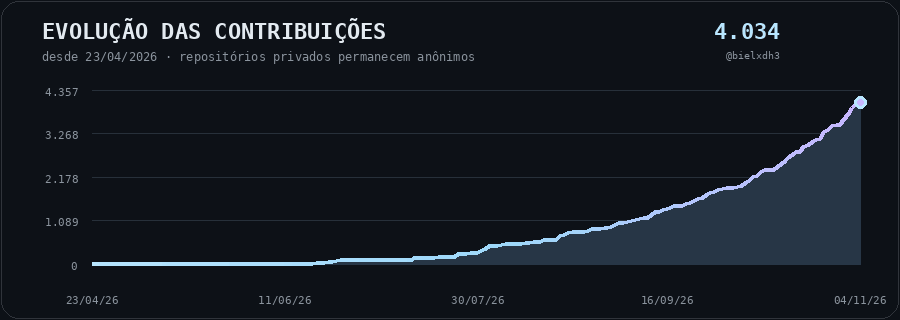

#  Olá, eu sou o G̷̦̭̣̮̳̤̯̐̔̓͛̿̏a̴͔̤̅̍̄̈́̒͐̚b̵̡͇̤̻̖̏r̴̪̼̤̤̗̝̱͂̀͗͋͆i̵̧̺̳̬͉̦̲͛̽͝é̴͖̹͕͎̮̰̍́́l̸͎͖̩͈͕͋͆́

### IA local, ferramentas para desenvolvedores e software self-hosted

Construo projetos com foco em **privacidade, autonomia e controle do usuário** — de agentes de IA e benchmarks reproduzíveis a serviços e aplicativos que podem rodar na própria infraestrutura.

**[Projetos](#-projetos-em-destaque) · [Tecnologias](#-tecnologias) · [Meu site](https://biel.dev.br/)**

---

## 🛡️ Virki — meu projeto principal

O **Virki** é um ecossistema experimental privado no qual exploro como agentes, serviços, aplicações e ferramentas independentes podem se integrar sem depender de uma única aplicação monolítica.

**Foco:** IA, automação, arquitetura de software e infraestrutura.

> 🔒 **Desenvolvimento privado.** O código-fonte e os componentes internos não estão disponíveis publicamente.

---

## 🚀 Projetos em destaque

### ⚔️ [Prompt Arena](https://github.com/bielxdh3/Prompt-Arena) — benchmarks de IA local

Aplicativo desktop para **comparar modelos de linguagem com testes reproduzíveis**. Registra configurações, saídas, histórico e evidências de cada execução, em vez de depender apenas de capturas de tela ou impressões subjetivas.

**Ecossistema:** Ollama · LM Studio · llama.cpp/GGUF · provedores via API.

[Explorar o projeto](https://github.com/bielxdh3/Prompt-Arena) · [Releases](https://github.com/bielxdh3/Prompt-Arena/releases)

### 🤖 [A.I.P.](https://github.com/bielxdh3/AIP) — agentes independentes personalizáveis

Plataforma desktop **local-first** para agentes de IA com identidade, memória, conversas e estado persistente. A proposta é experimentar agentes individualizados sem exigir que seus dados e sua identidade dependam de um serviço na nuvem.

**Ecossistema:** Tauri · Rust · TypeScript · Python · modelos locais.

[Explorar o projeto](https://github.com/bielxdh3/AIP)

### 🌌 [Frontier Models](https://github.com/bielxdh3/Frontiers-Models) — benchmarks de modelos de fronteira

Coleção de experimentos de programação com **prompts exatos, código inspecionável, snapshots e proveniência**. Inclui projetos interativos que permitem comparar as entregas dos modelos, como **Racing-bench** e **Orbitarium-bench**.

[Explorar os benchmarks](https://github.com/bielxdh3/Frontiers-Models) · [Racing-bench](https://github.com/bielxdh3/Frontiers-Models/tree/main/benchmarks/racing) · [Orbitarium-bench](https://github.com/bielxdh3/Frontiers-Models/tree/main/benchmarks/solar-system)

### 🗄️ [Root.ark](https://github.com/bielxdh3/Root.ark) — armazenamento self-hosted

Sistema de armazenamento e sincronização de arquivos com **controle de acesso, compartilhamento, versionamento, backups e WebDAV**, projetado para ambientes administrados pelo próprio usuário.

**Ecossistema:** Node.js · SQLite · armazenamento local e integrações opcionais.

> ⚠️ Em desenvolvimento. Não é recomendado para exposição pública ou uso em produção sem revisão específica de segurança.

[Explorar o projeto](https://github.com/bielxdh3/Root.ark)

### 🔐 [L-Vault](https://github.com/bielxdh3/L-vault) — backups sob seu controle

Gerenciador local para organizar, consultar e verificar backups do **Gmail e Google Takeout**. Tem foco em deduplicação, integridade dos arquivos, pesquisa e recuperação de dados.

**Ecossistema:** Python · armazenamento local · Google Takeout.

[Explorar o projeto](https://github.com/bielxdh3/L-vault)

### 💰 [deManage](https://github.com/bielxdh3/demanage) — finanças pessoais

Aplicativo self-hosted para acompanhar **receitas, despesas, cartões, orçamento mensal, objetivos de poupança e patrimônio**, com foco no uso pessoal em reais (BRL).

**Ecossistema:** React · TypeScript · Node.js · PostgreSQL.

[Explorar o projeto](https://github.com/bielxdh3/demanage) · [Site](https://demanage.biel.dev.br/)

---

## 🧪 Experimentos arquivados

- **[Dual Agents](https://github.com/bielxdh3/Dual-Agents):** experimento de orquestração de agentes de programação com papéis e provedores distintos.
- **[V-Lab](https://github.com/bielxdh3/V-Lab):** laboratório local de voz, preparação de datasets e experimentos com síntese de fala.

Esses repositórios estão **arquivados** e são mantidos como referência, não como projetos em desenvolvimento ativo.

---

## 🧰 Tecnologias

Minha principal área de interesse é a interseção entre **IA local, engenharia de software, infraestrutura self-hosted e experimentação reproduzível**.

---

## 📈 Evolução das contribuições

  

---

**Construindo, testando e descobrindo até onde dá para levar uma ideia.**

[GitHub](https://github.com/bielxdh3?tab=repositories) · [biel.dev.br](https://biel.dev.br/)

